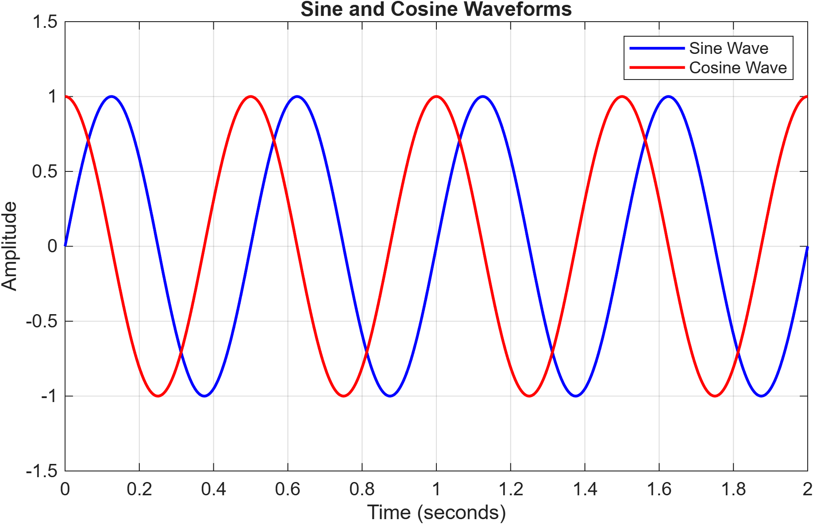
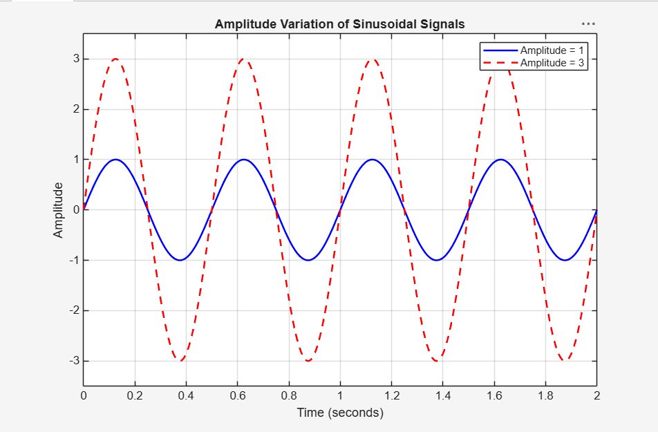
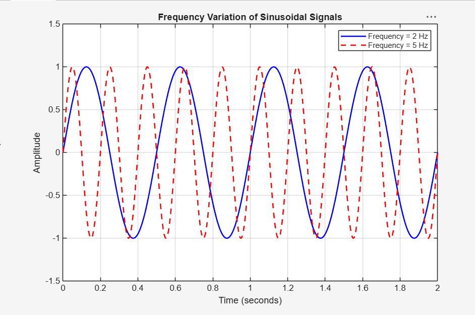
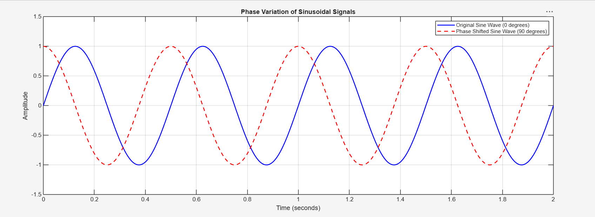

# Project 01 — Sine and Cosine Waveform Generator

A beginner-level MATLAB project to generate, plot and analyse basic sinusoidal signals.

## 📌 Project Overview

Sinusoidal signals are fundamental to Electronics and Communication Engineering. They are widely used in signal processing, communication systems, circuit analysis and other engineering applications.

This project explores the generation and visualisation of sine and cosine waveforms, along with the effects of changing amplitude, frequency and phase.

## 🎯 Objectives

- Generate sine and cosine signals using mathematical equations.
- Understand the role of amplitude, frequency and phase.
- Visualise sinusoidal waveforms using MATLAB plots.
- Observe how changing signal parameters affects waveform characteristics.

## 🧮 Mathematical Background

The general equation of a sinusoidal signal is:

\[
x(t)=A\sin(2\pi ft+\phi)
\]

Where:

| Parameter | Description | Value |
|---|---|---|
| A | Amplitude | 1 (baseline) |
| f | Frequency | 2 Hz (baseline) |
| Fs | Sampling Frequency | 1000 Hz |
| φ | Phase | 0 radians (baseline) |

The cosine waveform is represented as:

\[
y(t)=A\cos(2\pi ft)
\]

## ⚙️ Experiments

### Experiment 01 — Sine and Cosine Waveform Generation

Generates and plots sine and cosine signals with the same amplitude and frequency. The two signals have a phase difference of 90°.



**MATLAB file:** `01_Sine_Cosine_Generator.m`

### Experiment 02 — Amplitude Variation

Compares two sinusoidal signals with amplitudes of 1 and 3 while keeping frequency constant at 2 Hz.

**Observation:** Increasing amplitude increases the peak value of the waveform without changing its frequency.



**MATLAB file:** `amplitude_variation.m`

### Experiment 03 — Frequency Variation

Compares two sinusoidal signals with frequencies of 2 Hz and 5 Hz while keeping amplitude constant at 1.

**Observation:** The 5 Hz signal completes more cycles in the same time interval than the 2 Hz signal.



**MATLAB file:** `frequency_variation.m`

### Experiment 04 — Phase Variation

Compares two sinusoidal signals with phase offsets of 0° and 90°, while keeping amplitude and frequency constant.

**Observation:** A positive phase offset of 90° shifts the waveform to the left, so the shifted signal leads the original signal.



**MATLAB file:** `phase_variation.m`

> **Note:** This experiment demonstrates a fixed phase shift (phase comparison), not time-varying phase modulation (PM).

## 🛠️ Tools and Technologies

- MATLAB
- MATLAB Plotting Functions
- GitHub

## 📁 Project Structure

```text
01_Sine_Cosine_Generator/
│
├── 01_Sine_Cosine_Generator.m
├── amplitude_variation.m
├── frequency_variation.m
├── phase_variation.m
├── README.md
│
└── Results/
    ├── sine_cosine.png
    ├── amplitude_variation.final.png
    ├── frequency_variation.final.png
    └── phase_comparison.png
```

## ▶️ How to Run

1. Clone or download this repository.
2. Open MATLAB.
3. Set the Current Folder to `01_Sine_Cosine_Generator`.
4. Run the required `.m` file:
   - `01_Sine_Cosine_Generator.m`
   - `amplitude_variation.m`
   - `frequency_variation.m`
   - `phase_variation.m`
5. The amplitude, frequency and phase experiment scripts save their plots in the `Results` folder. Ensure that the `Results` folder exists before running them.

## 📚 Key Learnings

- Generating sinusoidal signals using sampled time vectors.
- Understanding amplitude, frequency and phase.
- Comparing sine and cosine waveforms.
- Observing how signal parameters affect waveform characteristics.
- Plotting and saving results using MATLAB.

## 🚀 Future Improvements

- Explore the effect of sampling frequency on waveform representation.
- Study phase modulation and other communication-system applications.
- Extend the project towards basic signal analysis.

---

**Project 01 of my 20-Day MATLAB-Engineering Project Challenge.**

*Learning, experimenting and building one project at a time.* ♡
