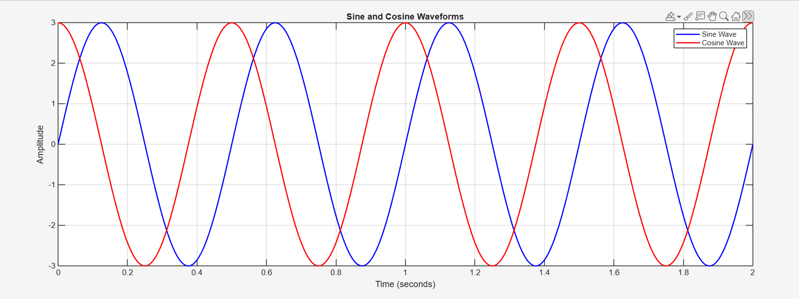
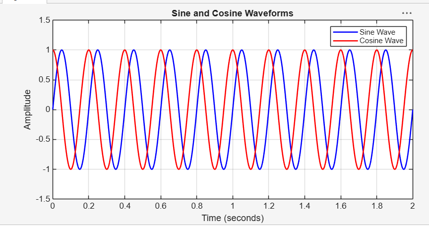

# Project 01 — Sine and Cosine Waveform Generator

A beginner-level MATLAB project to generate, plot and analyse basic sinusoidal signals.

## 📌 Project Overview

Sinusoidal signals are fundamental to Electronics and Communication Engineering. They are widely used in signal processing, communication systems, circuit analysis and other engineering applications.

This project explores the generation and visualisation of sine and cosine waveforms using MATLAB.

## 🎯 Objectives

- Generate sine and cosine signals using mathematical equations.
- Understand the role of amplitude, frequency and phase.
- Visualise sinusoidal waveforms using MATLAB plots.
- Observe how changing signal parameters affects waveform characteristics.

## 🧮 Mathematical Background

The general equation of a sinusoidal signal is:

\[
x(t)=A\sin(2\pi ft+\phi)
\]

Where:

| Parameter | Description | Value |
|---|---|---|
| A | Amplitude | 1 |
| f | Frequency | 2 Hz |
| Fs | Sampling Frequency | 1000 Hz |
| φ | Phase | 0 radians |

The cosine waveform is represented as:

\[
y(t)=A\cos(2\pi ft)
\]

## ⚙️ Implementation

The MATLAB script performs the following operations:

1. Defines the signal parameters.
2. Creates a time vector for a duration of 2 seconds.
3. Generates sine and cosine signals.
4. Plots both waveforms on the same figure.
5. Adds labels, a title, grid and legend.
6. Sets appropriate axis limits for better visualisation.

## 📊 Results and Observations

### 1. Sine and Cosine Waveforms

The generated sine and cosine signals have the same amplitude and frequency, with a phase difference of 90°.


### 2. Amplitude Variation

The amplitude of a sinusoidal signal determines its peak value. Increasing amplitude increases the vertical extent of the waveform without changing its frequency.



### 3. Frequency Variation

Frequency determines the number of cycles completed per second. Increasing frequency results in more cycles within the same time interval.



### 4. Phase Comparison

Phase determines the relative position of a waveform along the time axis. A phase change of 90° shifts the sinusoidal waveform relative to the original signal.


> **Note:** The current MATLAB source file reproduces the baseline sine and cosine waveform plot. The variation plots are included as experiment results; their corresponding reproducible scripts will be added separately.

## 🛠️ Tools and Technologies

- MATLAB
- MATLAB Plotting Functions
- GitHub

## 📁 Project Structure

```text
01_Sine_Cosine_Generator/
│
├── 01_Sine_Cosine_Generator.m
│
├── README.md
│
└── Results/
    ├── sine_cosine.png
    ├── amplitude_variation.png
    ├── frequency_variation.png
    └── phase_comparison.png
```

## ▶️ How to Run

1. Clone or download this repository.
2. Open MATLAB.
3. Navigate to the `01_Sine_Cosine_Generator` folder.
4. Open `01_Sine_Cosine_Generator.m`.
5. Run the script.

## 📚 Key Learnings

- Generating continuous-time sinusoidal signals using sampled time vectors.
- Understanding amplitude and frequency.
- Understanding the phase relationship between sine and cosine.
- Plotting and visualising signals in MATLAB.
- Using MATLAB commands for graph formatting.

## 🚀 Future Improvements

- Add separate MATLAB scripts for amplitude, frequency and phase variation.
- Automate the export of result plots.
- Explore the effect of sampling frequency on waveform representation.
- Extend the project towards basic signal analysis.

---

**Project 01 of my 50-Day Engineering Project Challenge.**

*Learning, experimenting and building one project at a time.* ♡
