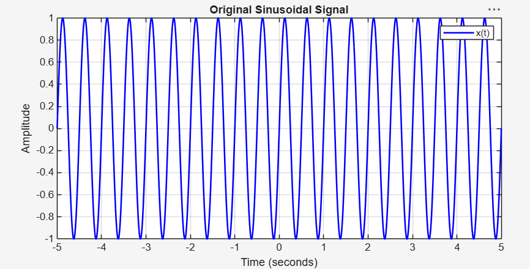
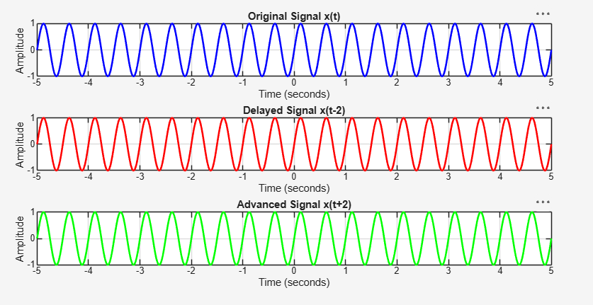
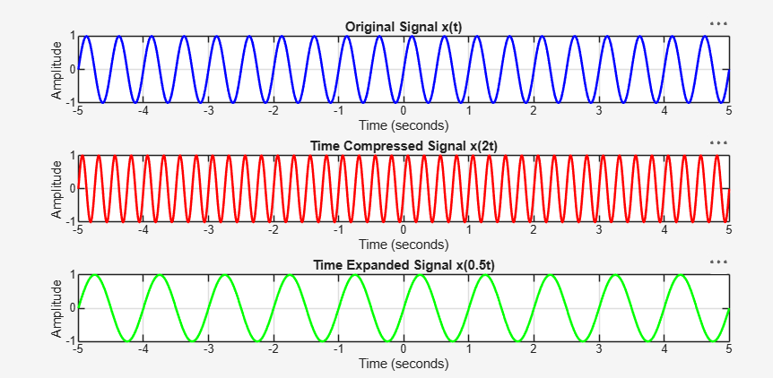
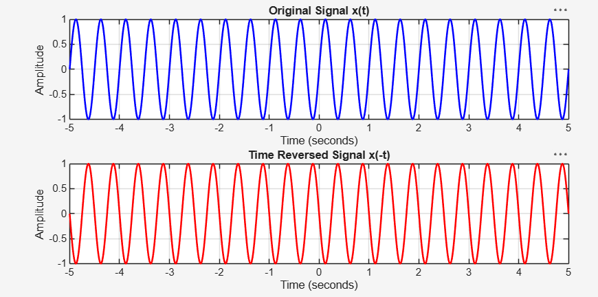

# Project 03: Time Shifting and Scaling of Signals

## Aim

To study and simulate the effects of time shifting, time scaling, and time reversal on continuous-time sinusoidal signals using MATLAB.

## 1. Signal Parameters

| Parameter | Symbol | Value |
|---|---|---:|
| Amplitude | A | 1 |
| Frequency | f | 2 Hz |
| Sampling Frequency | Fs | 1000 Hz |
| Sampling Period | T | 0.001 s |
| Time Range | t | -5 to 5 seconds |

## 2. Mathematical Operations

The original sinusoidal signal is defined as:

\[
x(t)=A\sin(2\pi ft)
\]

The following transformations are performed:

| Operation | Mathematical Expression | Description |
|---|---|---|
| Original Signal | \(x(t)\) | Reference signal |
| Time Delay | \(x(t-2)\) | Shifts signal 2 seconds right |
| Time Advance | \(x(t+2)\) | Shifts signal 2 seconds left |
| Time Compression | \(x(2t)\) | Compresses signal along time axis |
| Time Expansion | \(x(0.5t)\) | Expands signal along time axis |
| Time Reversal | \(x(-t)\) | Reverses signal along time axis |

## 3. MATLAB Implementation

The project consists of four MATLAB scripts:

| Script | Functionality |
|---|---|
| `original_signal.m` | Generates and plots the original sinusoidal signal |
| `time_shifting.m` | Demonstrates time delay and time advance |
| `time_scaling.m` | Demonstrates time compression and expansion |
| `time_reversal.m` | Demonstrates time reversal |

## 4. Simulation Results

All simulation plots are generated using MATLAB and saved in the `Results/` directory at 300 DPI resolution.

### 4.1 Original Sinusoidal Signal



### 4.2 Time Shifting

Demonstrates the effects of delaying and advancing a sinusoidal signal.



### 4.3 Time Scaling

Demonstrates time compression and expansion.



### 4.4 Time Reversal

Demonstrates the reflection of a signal about the vertical axis.



## 5. Key Observations

1. A positive time delay shifts the signal towards the right.
2. A positive time advance shifts the signal towards the left.
3. Time compression increases the frequency of oscillations.
4. Time expansion decreases the frequency of oscillations.
5. Time reversal reflects the signal about the vertical axis.
6. These transformations alter the time characteristics of the signal without changing its amplitude.

## 6. Tools and Technologies

- MATLAB
- Signal and Systems fundamentals
- MATLAB plotting functions
- `subplot()`
- `plot()`
- `exportgraphics()`
- `mkdir()`

## 7. Learning Outcomes

Through this project, the following concepts were explored:

- Generation of continuous-time sinusoidal signals.
- Understanding time shifting operations.
- Understanding time compression and expansion.
- Visualisation of time reversal.
- MATLAB signal generation and plotting.
- Organising simulation outputs and exporting high-resolution figures.

## 8. Repository Structure

```text
03_Time_Shifting_and_Scaling/
│
├── original_signal.m
├── time_shifting.m
├── time_scaling.m
├── time_reversal.m
├── README.md
│
└── Results/
    ├── original_signal.png
    ├── time_shifting.png
    ├── time_scaling.png
    └── time_reversal.png
```

---

**Project Status:** Completed

**Challenge:** 20 MATLAB Engineering Projects in 20 Days
