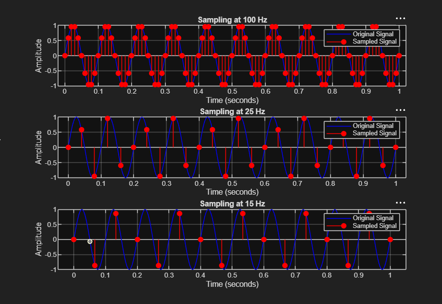
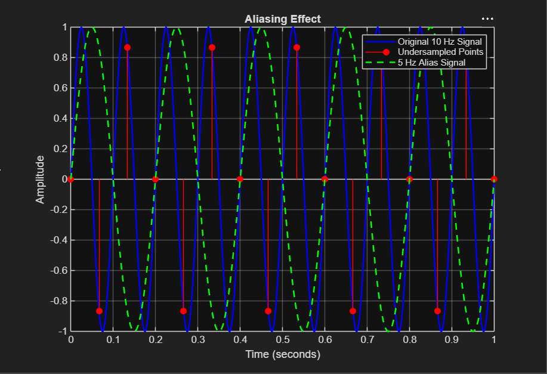

# Project 04: Sampling and Aliasing Simulator

## Aim

To study the process of sampling a sinusoidal signal at different sampling frequencies and understand the effects of undersampling and aliasing using MATLAB.

## 1. Signal Parameters

| Parameter | Symbol | Value |
|---|---|---:|
| Amplitude | A | 1 |
| Message Frequency | fm | 10 Hz |
| Sampling Frequency 1 | Fs1 | 100 Hz |
| Sampling Frequency 2 | Fs2 | 25 Hz |
| Sampling Frequency 3 | Fs3 | 15 Hz |
| Simulation Duration | t | 1 second |

## 2. Theoretical Background

Sampling converts a continuous-time signal into a discrete-time sequence by measuring its amplitude at regular time intervals.

According to the Nyquist Sampling Theorem, the sampling frequency must be at least twice the highest frequency component of the original signal to avoid aliasing.

\[
f_s \geq 2f_m
\]

For this experiment:

\[
f_m=10\text{ Hz}
\]

\[
f_{s(min)}=20\text{ Hz}
\]

## 3. MATLAB Implementation

| Script | Functionality |
|---|---|
| `original_signal.m` | Generates the original sinusoidal signal |
| `sampling_comparison.m` | Compares sampling at three different frequencies |
| `aliasing_analysis.m` | Calculates and visualises the aliasing effect |

## 4. Simulation Results

### 4.1 Original Signal


### 4.2 Sampling Comparison



### 4.3 Aliasing Analysis



## 5. Key Observations

1. Sampling at 100 Hz provides a dense representation of the original signal.
2. Sampling at 25 Hz satisfies the Nyquist criterion.
3. Sampling at 15 Hz violates the Nyquist criterion and produces aliasing.
4. Aliasing causes a higher-frequency signal to appear as a lower-frequency signal.
5. Proper selection of sampling frequency is essential for accurate signal reconstruction.

## 6. Tools and Technologies

- MATLAB
- Signal Processing fundamentals
- `plot()`
- `stem()`
- `subplot()`
- `fprintf()`
- `exportgraphics()`

## 7. Learning Outcomes

- Understanding the sampling process.
- Applying the Nyquist Sampling Theorem.
- Comparing different sampling frequencies.
- Identifying undersampling and aliasing.
- Calculating apparent alias frequencies.
- Visualising sampled signals using MATLAB.

## 8. Repository Structure

```text
04_Sampling_and_Aliasing/
│
├── original_signal.m
├── sampling_comparison.m
├── aliasing_analysis.m
├── README.md
│
└── Results/
    ├── original_signal.png
    ├── sampling_comparison.png
    └── aliasing_analysis.png
```

---

**Project Status:** Completed

**Challenge:** 20 MATLAB Engineering Projects in 20 Days
